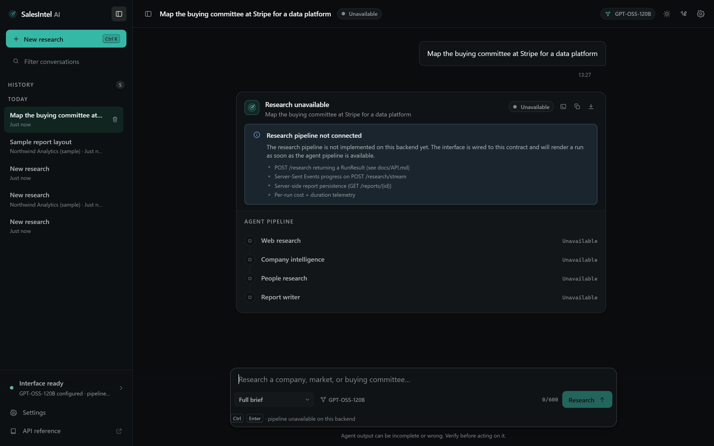
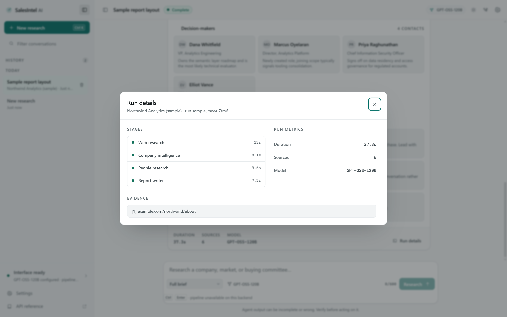
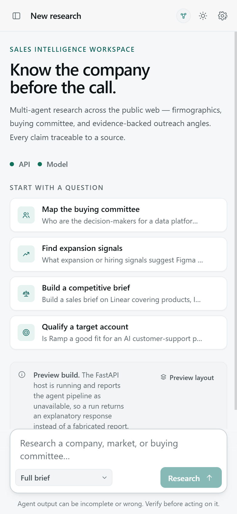

# SalesIntel AI

A multi-agent sales-intelligence workspace: research a company, map its buying
committee, and produce an evidence-backed sales brief — with every claim tied to
a source or explicitly marked as uncertain.

The interface is built as a production-oriented enterprise product, not a demo
shell. It is **contract-first**: it reads `GET /health`, renders only the
capabilities the backend actually reports, and says so in plain language when
something is unavailable.

---

## Status: what is real, and what is not

This matters more than any feature list, so it comes first.

| Area | State |
| --- | --- |
| Research workspace UI | **Implemented** — full interface, themes, responsive, accessible |
| FastAPI host, security headers, static serving | **Implemented** |
| Honest health & capability reporting (`/health`) | **Implemented** |
| Request contract + validation for `/research` | **Implemented** (Pydantic) |
| LangGraph agent pipeline | **Not implemented** — returns HTTP 501 |
| SSE streaming progress | **Not implemented** — returns HTTP 501 |
| Server-side report persistence | **Not implemented** |
| Cost / token telemetry | **Not implemented** (rendered only if the API returns it) |

`POST /research` answers with a `501` and a machine-readable `code`. The UI
renders that as an explicit "Research pipeline not connected" state listing the
capabilities the backend must gain — it does **not** show fake agent progress,
invented citations, or placeholder metrics.

The single exception is an explicitly labelled **sample layout preview**
(`Preview layout` on the empty state). It is static local data used to review
report typography while the pipeline is missing. It carries a `Sample` badge, a
warning banner, a `SAMPLE DATA` line in exports, and contains no cost or token
figures. It is never presented as an API response.

### Reference screenshots

Captured from the running app (see [`docs/screenshots/`](docs/screenshots)).

| | |
| --- | --- |
|  |  |
| Empty state — hero, status checks, query starters | Research brief — agent timeline, report, structured blocks |
|  |  |
| Dark theme | Honest "pipeline not connected" state |
|  |  |
| Run details — stage timings, metrics, evidence | System status — real capability reporting |
|  |  |
| Mobile empty state | Mobile report |

---

## Running

```powershell
.venv\Scripts\python.exe main.py      # http://127.0.0.1:8000
```

Or with uvicorn directly:

```powershell
.venv\Scripts\python.exe -m uvicorn main:app --host 127.0.0.1 --port 8000
```

Backend contract tests (no extra dependencies required):

```powershell
.venv\Scripts\python.exe tests\test_api.py     # 14/14
```

Interactive API docs: <http://127.0.0.1:8000/docs>

### Configuration

Copy real values into `.env` (already git-ignored). Keys are read server-side
only; the browser receives booleans, never secrets.

| Variable | Purpose |
| --- | --- |
| `GROQ_API_KEY` | Groq credential for GPT-OSS-120B |
| `GROQ_MODEL` | Model id, e.g. `openai/gpt-oss-120b` |
| `TREG_API_KEY` | Treg research tool credential |
| `TREG_MAX_USD` | Per-run research spend cap |

---

## Architecture

```
main.py                     FastAPI host: routes, honest health, security headers
docs/API.md                 Endpoint contract + proposed RunResult / SSE schemas
tests/test_api.py           Dependency-free contract tests (14 assertions)

templates/index.html        Single application shell: sidebar, thread, composer,
                            dialogs, icon sprite, <template> definitions

static/css/
  tokens.css                Design tokens — colour, type, space, radius, motion
  base.css                  Reset, element defaults, a11y primitives
  layout.css                App shell, sidebar, workspace, composer dock
  components.css            Buttons, inputs, menus, dialogs, toasts, switches
  thread.css                Messages, run card, agent stages, report prose
  responsive.css            Breakpoints, short viewports, print, forced colours

static/js/
  theme-init.js             Pre-paint theme resolution (no flash of wrong theme)
  app.js                    Controller: wiring, state, run lifecycle, keyboard
  api.js                    Typed fetch client, ApiError, SSE reader
  model.js                  Untrusted payload → view model, defensive accessors
  render.js                 DOM construction (textContent only, no innerHTML)
  markdown.js               Safe Markdown renderer (DOM-built, no HTML strings)
  threads.js                Conversation store with persistence notifications
  store.js                  localStorage layer + settings defaults
  ui.js                     Toasts, dialogs, autosize, copy feedback, scrolling
  util.js                   Small pure helpers
  sample.js                 Labelled static layout preview
  config.js                 Agents, suggestions, limits, capability metadata
```

Design decisions worth knowing:

- **No framework, no build step.** ES modules served directly; the only
  dependencies are the ones already in `pyproject.toml`.
- **Presentation is separated from logic.** `render.js` builds DOM, `model.js`
  normalises data, `app.js` orchestrates. No module reaches across concerns.
- **Run state is a small state machine** (`queued → running → complete |
  partial | failed | unavailable`) mirrored in `data-run-status` for styling and
  testing.
- **Stages start as `waiting`.** Nothing shows "running" or "complete" until the
  backend says so; the interface cannot imply progress that did not happen.

---

## Design system

Restrained neutral ground with a single jade signal accent — closer to a
professional tool than an AI product page.

- **Colour**: semantic tokens only (`--bg-surface`, `--text-secondary`,
  `--accent`, …); raw palette values live in `tokens.css`. Light and dark are
  complete, independent themes.
- **Type**: system sans stack, tight display tracking, tabular numerals for all
  metrics. No webfont requests, so first paint is instant and CSP stays strict.
- **Space**: one 4px-based scale; density is a token swap (`comfortable` /
  `compact`) rather than a second stylesheet.
- **Depth**: four shadow steps plus hairline borders; elevation is used to
  separate layers, never decoration.
- **Motion**: 110–380 ms, `cubic-bezier` easing, all of it opt-out. Respects
  `prefers-reduced-motion` and exposes a manual override.

### Interface details

- Collapsible sidebar with local search, day-grouped history and per-item delete.
- Agent pipeline rendered as a stateful timeline with per-stage durations.
- Structured report blocks (company facts, decision-makers, opportunities)
  alongside the Markdown narrative.
- Numeric citation markers (`[1]`) in prose that scroll to and flash the matching
  source card; only rendered when the source actually exists.
- Run detail dialog: stage timings, metrics, tool calls, evidence payloads.
- Copy / download Markdown with the report, facts, people, opportunities,
  sources and evidence appended.
- Live elapsed timer, cancellable runs, and a composer that becomes a Stop
  button mid-flight.

---

## Accessibility

Verified in-browser rather than assumed:

- Contrast: every text token measured at **≥ 4.5:1** in both themes
  (body 17.3:1, secondary prose 7.8:1, smallest meta 4.7:1).
- All dialogs are native `<dialog>` with focus trapping and Escape support.
- No unnamed interactive elements; all inputs have real labels; no duplicate ids.
- Live regions for status and toasts; skip link; visible focus rings.
- Touch targets ≥ 24×24 px (WCAG 2.2 SC 2.5.8); inline citation markers exempt.
- `prefers-reduced-motion`, forced-colours and print stylesheets included.

Verified in-browser rather than assumed:

- Contrast: every text token measured at **≥ 4.5:1** in both themes
  (body 17.3:1, secondary prose 7.8:1, smallest meta 4.7:1).
- All dialogs are native `<dialog>` with focus trapping and Escape support.
- No unnamed interactive elements; all inputs have real labels; no duplicate ids.
- Live regions for status and toasts; skip link; visible focus rings.
- Touch targets ≥ 24×24 px (WCAG 2.2 SC 2.5.8); inline citation markers exempt.
- `prefers-reduced-motion`, forced-colours and print stylesheets included.

## Security

- Model output is **never** assigned as HTML. `markdown.js` builds DOM nodes and
  only creates text nodes; 24 hostile payloads (script tags, `onerror`,
  `javascript:`/`data:`/`vbscript:` URLs, attribute injection) produced zero
  executions and zero dangerous attributes in testing.
- All links pass through `safeUrl()` — only `http(s)` survives; external links
  use `rel="noopener noreferrer"`.
- API keys never leave the server. `/health` exposes presence booleans only.
- Strict CSP (`default-src 'self'`, no `unsafe-inline`) applied to all app routes.

---

## Missing API capabilities

The interface is wired for capabilities the backend must still provide. Full
shapes are in [`docs/API.md`](docs/API.md); in short:

1. **`POST /research` → `RunResult`** — company, report Markdown, citations,
   per-stage states with durations, optional `usage` (cost, tokens, model).
2. **`POST /research/stream` (SSE)** — `stage`, `delta`, `notice`, `done`,
   `error` events. The client already parses these; the UI switches transport
   automatically when `capabilities.streaming` is `true`.
3. **Server-side history** — `GET /reports`, `GET /reports/{id}`. Until then
   conversation history is explicitly labelled as browser-local.
4. **Per-run telemetry** — cost and duration. Rendered only when present.

Once `capabilities.research` becomes `true`, the UI stops showing the preview
notice and runs render real reports with no frontend changes required.

---

## Keyboard

| Shortcut | Action |
| --- | --- |
| `Ctrl K` | New research |
| `Ctrl Enter` | Run research |
| `Ctrl B` | Toggle sidebar |
| `Ctrl ,` | Settings |
| `/` | Focus composer |
| `?` | Shortcut reference |
| `Esc` | Close dialog |

---

## Notes on trade-offs

- **localStorage over a server store** — the backend has no persistence, so
  history is local and says so. When `capabilities.history` is true the same
  component can hydrate from the API.
- **Sample preview exists** — a portfolio project that cannot show its report
  layout is hard to evaluate. It is isolated, labelled at four points, and holds
  no fabricated telemetry. Delete `static/js/sample.js` and the `preview-sample`
  action to remove it entirely.
- **No virtualised list** — threads are capped (60 conversations × 24 entries)
  well below the threshold where virtualisation would pay for itself.

