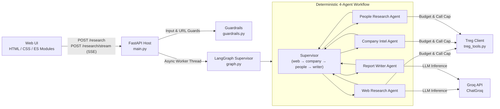
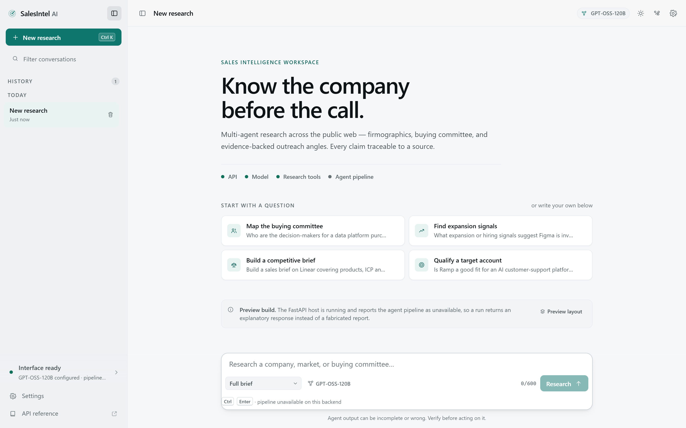
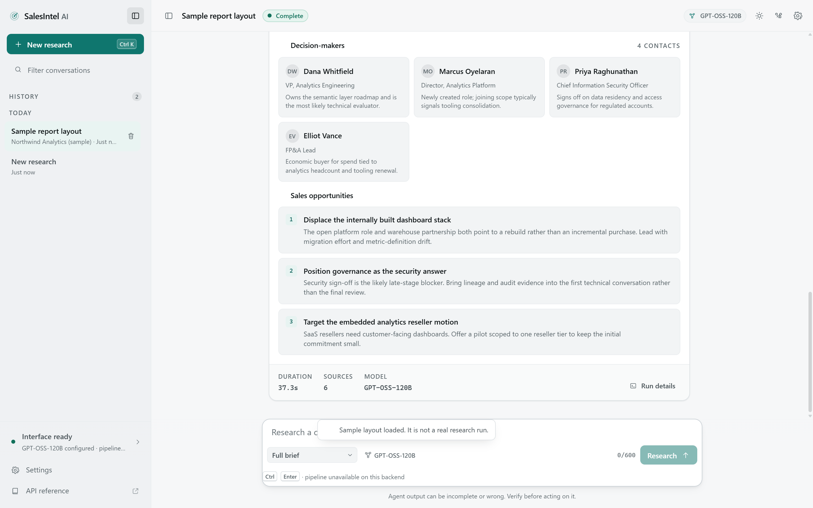
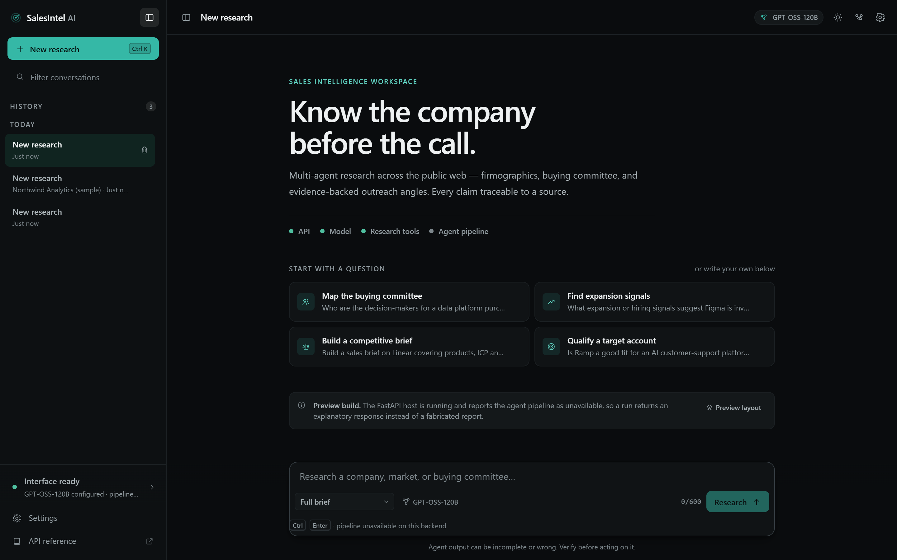
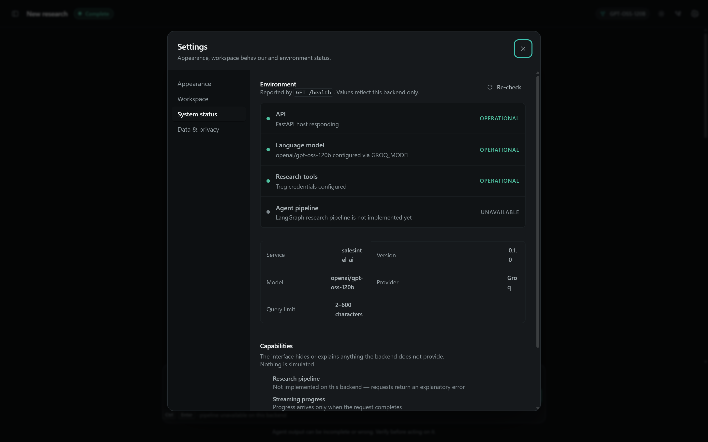
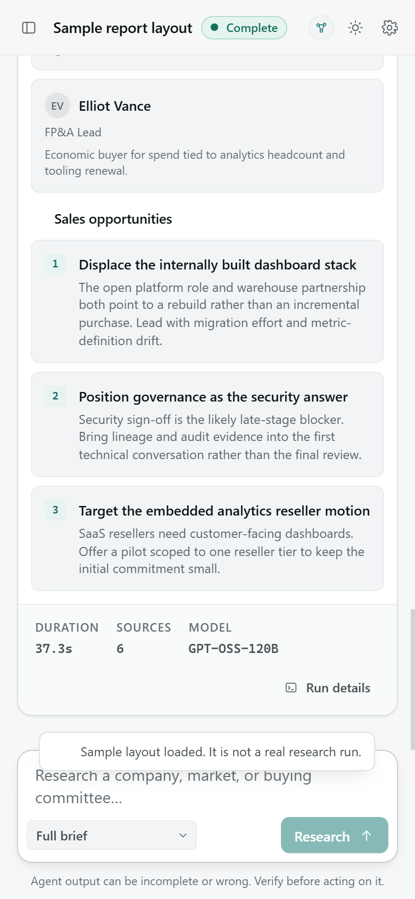

# SalesRadar

**Evidence-backed B2B sales intelligence powered by a deterministic LangGraph multi-agent pipeline, Groq LLMs, and Treg web/people research.**

SalesRadar researches a target company across the public web, maps key decision-makers, enriches firmographics, and synthesizes a structured sales brief with traceable citations—while enforcing strict input, URL, PII, citation, and cost guardrails at every step.

---

## Table of Contents

- [Architecture](#architecture)
- [Capabilities & Status](#capabilities--status)
- [Quick Start](#quick-start)
- [Configuration](#configuration)
- [Multi-Agent Pipeline & Guardrails](#multi-agent-pipeline--guardrails)
- [API Overview](#api-overview)
- [Frontend & Design System](#frontend--design-system)
- [Project Structure](#project-structure)
- [Testing](#testing)
- [Screenshots](#screenshots)

---

## Architecture



---

## Capabilities & Status

SalesRadar uses a **contract-first** UI: on load, the browser queries `GET /health` and enables capabilities strictly from what the backend reports.

| Capability | Status | Notes |
| --- | --- | --- |
| Research workspace UI | **Implemented** | Vanilla ES modules, light/dark/system themes, responsive layout, `<dialog>` modals |
| FastAPI host & security headers | **Implemented** | Strict CSP (`default-src 'self'`), `no-store` for HTML/JSON/SSE |
| Honest health & capability reporting | **Implemented** | `GET /health` checks `GROQ_API_KEY` & `TREG_API_KEY` presence only |
| 4-agent LangGraph research pipeline | **Implemented** | `POST /research` returning normalised `RunResult` JSON |
| Real-time SSE progress streaming | **Implemented** | `POST /research/stream` emitting live `stage`, `done`, and `error` events |
| Guardrails & PII redaction | **Implemented** | Input validation, HTTPS/public host checks, contact stripping, citation verification |
| Cost & token telemetry | **Implemented** | Per-run Treg spend (`cost_usd`), LLM token usage, and per-stage durations |
| Server-side report persistence | **Local only** | Conversations are stored in browser `localStorage` (`GET /reports/{id}` not yet routed) |

---

## Quick Start

### Prerequisites

- Python **3.13+**
- A [Groq](https://console.groq.com/) API key (`GROQ_API_KEY`)
- A [Treg](https://treg.to/) API key (`TREG_API_KEY`)

### 1. Install Dependencies

Using `uv` (recommended, lockfile included):

```powershell
uv sync
```

Or using `pip` in a virtual environment:

```powershell
python -m venv .venv
.venv\Scripts\activate
pip install -e .
```

### 2. Configure Environment

Create a `.env` file in the project root (git-ignored by default):

```env
GROQ_API_KEY=your_groq_api_key
GROQ_MODEL=openai/gpt-oss-120b
TREG_API_KEY=your_treg_api_key
TREG_MAX_USD=0.20
```

### 3. Run the Server

```powershell
.venv\Scripts\python.exe main.py
```

Or with Uvicorn directly:

```powershell
.venv\Scripts\python.exe -m uvicorn main:app --host 127.0.0.1 --port 8000
```

Open in your browser:
- **Workspace UI:** <http://127.0.0.1:8000>
- **Interactive API Docs (Swagger):** <http://127.0.0.1:8000/docs>
- **ReDoc:** <http://127.0.0.1:8000/redoc>

---

## Configuration

All secrets are read server-side via `python-dotenv` (`load_dotenv`, existing process environment takes precedence) and are never logged or exposed to the browser.

| Variable | Default | Description |
| --- | --- | --- |
| `GROQ_API_KEY` | — | **Required.** Credential for Groq LLM inference (`ChatGroq`). |
| `GROQ_MODEL` | `openai/gpt-oss-120b` | Groq model identifier used for company extraction, URL resolution, and brief writing. |
| `TREG_API_KEY` | — | **Required.** Credential sent via `X-Treg-Token` to `https://treg.to`. |
| `TREG_MAX_USD` | `0.20` | Hard per-run USD budget cap enforced in micro-dollars (`X-Treg-Route-Max-Cost`). |
| `TREG_SEARCH_METHOD` / `TREG_SEARCH_BODY` | `POST` / `{"q": ...}` | Optional override for `treg.web.search` HTTP method and JSON template (`{q}` / `{query}`). |
| `TREG_PEOPLE_METHOD` / `TREG_PEOPLE_BODY` | `POST` / `{"company_domain": ...}` | Optional override for `treg.people.search` HTTP method and JSON template (`{domain}`). |
| `TREG_SCRAPE_*` / `TREG_COMPANY_*` | — | Optional overrides for `treg.web.extract` and company enrichment endpoints. |

---

## Multi-Agent Pipeline & Guardrails

### Deterministic Graph (`graph.py`)

Rather than allowing open-ended agent loops, `supervisor` enforces a fixed execution sequence with `recursion_limit=15`:

1. **`web`** — Queries Treg web search for the target company (incorporating any user `focus`), asks the LLM to identify the official HTTPS homepage, verifies the host actually appeared in search results, and scrapes the homepage.
2. **`company`** — Enriches company overview, industry, headquarters, and products for the verified domain (`treg.company`).
3. **`people`** — Searches for leadership and buying-committee roles for the verified domain (`treg.people`).
4. **`writer`** — Synthesizes a structured Markdown brief (`Company overview`, `Products and news`, `Key people`, `Sales hypotheses`, `Limitations`) grounded strictly in numbered evidence rows (`[1]`, `[2]`, ...).

### Safety & Quality Controls (`guardrails.py` & `treg_tools.py`)

- **Input validation:** `valid_company` (2–100 chars, restricted safe characters) and `valid_query` (2–600 chars, control characters stripped).
- **SSRF & URL validation:** `safe_url` allows public `https://` URLs only—rejecting HTTP, embedded credentials, IP literals, non-443 ports, and `.local`/`.internal`/`.localhost` hosts.
- **PII / contact scrubbing:** `public_data` recursively removes keys matching `email`, `phone`, `mobile`, `address`, `contact`, `password`, or `token`, and redacts email patterns before evidence enters LLM prompts.
- **Prompt injection defense:** System prompts instruct the model to treat all retrieved evidence strictly as untrusted data.
- **Citation & leak verification:** `writer` verifies that every `[n]` citation maps to a real evidence item and rejects responses containing raw `http(s)://` URLs or email addresses.
- **Cost & execution caps:** `Treg` enforces `TREG_MAX_USD`, limits each run to 4 external calls, and halts further calls on network failure or HTTP `202` pending state.

---

## API Overview

Full request/response schemas and SSE event specifications are documented in [`docs/API.md`](docs/API.md).

| Method & Path | Description |
| --- | --- |
| `GET /` | Serves the single-page research workspace (`templates/index.html`). |
| `GET /health` | Returns service status, configured model, environment checks, capability booleans, and input limits. |
| `POST /research` | Runs the 4-agent pipeline in a worker thread and returns a full `RunResult` JSON payload. |
| `POST /research/stream` | Streams real-time `stage` progress events and the final `done` (`RunResult`) over `text/event-stream`. |
| `GET /docs` | Interactive Swagger UI documentation. |

---

## Frontend & Design System

Built without build tools or frontend frameworks using native ES modules and CSS custom properties:

- **Security-first rendering:** `static/js/markdown.js` and `static/js/render.js` build DOM nodes exclusively via `document.createElement` and `textContent` (no `innerHTML` on model output). All citation links pass `safeUrl()` and open with `rel="noopener noreferrer"`.
- **Design tokens:** `static/css/tokens.css` defines independent light and dark themes, a 4px spacing scale, comfortable/compact density modes, and `prefers-reduced-motion` support.
- **Interactive features:** Collapsible history sidebar with live filtering, per-stage timeline with millisecond durations, clickable inline citation markers `[1]` that highlight matching source cards, Run Details modal (timings, metrics, tool calls, evidence), and one-click Markdown export.

### Keyboard Shortcuts

| Shortcut | Action |
| --- | --- |
| `Ctrl K` | New research thread |
| `Ctrl Enter` | Submit research query |
| `Ctrl B` | Toggle sidebar |
| `Ctrl ,` | Open settings |
| `/` | Focus composer |
| `?` | Open keyboard shortcuts |
| `Esc` | Close active dialog |

---

## Project Structure

```text
SalesRadar/
├── main.py                 FastAPI host, routes, SSE streaming, security & cache headers
├── graph.py                LangGraph 4-agent state graph, ChatGroq calls, RunResult mapper
├── guardrails.py           Input, URL (SSRF), and PII/contact sanitization helpers
├── treg_tools.py           Budget-capped Treg HTTP client (search, scrape, company, people)
├── pyproject.toml          Python >=3.13 project metadata and dependencies
├── docs/
│   ├── API.md              Full HTTP & SSE contract documentation
│   └── screenshots/        Reference UI captures (light, dark, mobile, tablet)
├── templates/
│   └── index.html          Workspace shell, icon sprite, dialogs, HTML templates
├── static/
│   ├── favicon.svg         Application icon
│   ├── css/                Design tokens, layout, components, thread prose, responsive rules
│   └── js/                 ES modules (app, api, model, render, markdown, store, threads, ui)
└── tests/
    └── test_api.py         Dependency-free contract & guardrail test suite
```

---

## Testing

The test suite uses FastAPI's `TestClient` and mocks `run_research` for endpoint contract tests so no live Groq or Treg credits are spent:

```powershell
.venv\Scripts\python.exe tests\test_api.py
```

Covers HTML rendering, strict security/CSP headers, `/health` credential presence checks, `503` unconfigured handling, `POST /research` & `POST /research/stream` SSE contracts, `422` input validation, guardrail helpers, and static asset serving (`16/16` assertions).

---

## Screenshots

| | |
| --- | --- |
|  |  |
| Empty workspace — status checks & starters | Research brief — agent pipeline, report & blocks |
|  |  |
| Dark theme | Run details — stage timings, tool calls & evidence |
|  |  |
| System status — live `/health` capability flags | Mobile responsive report |
